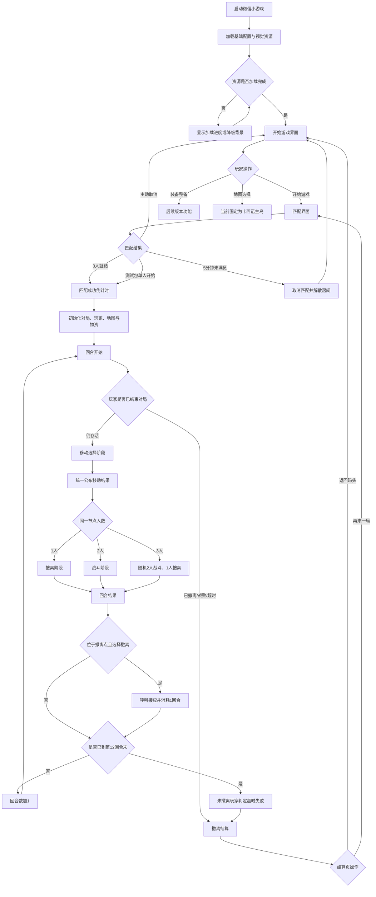
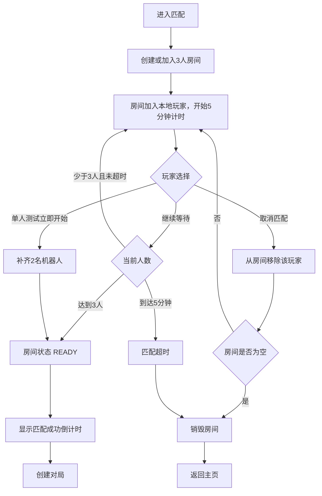
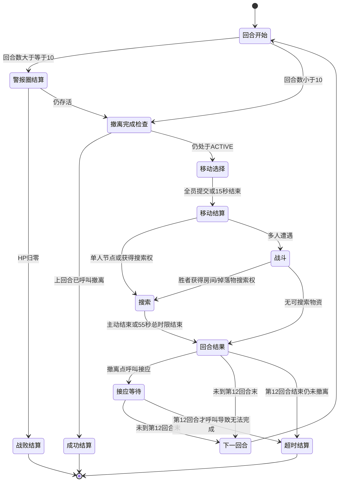
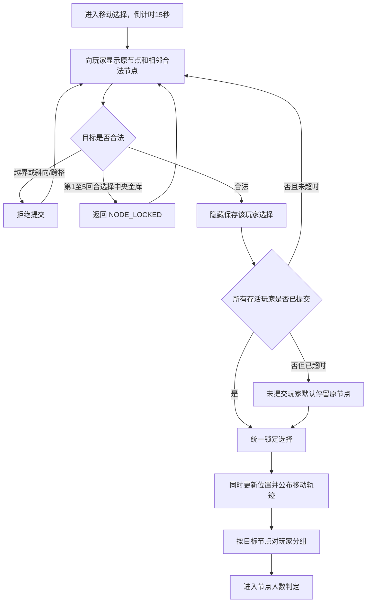
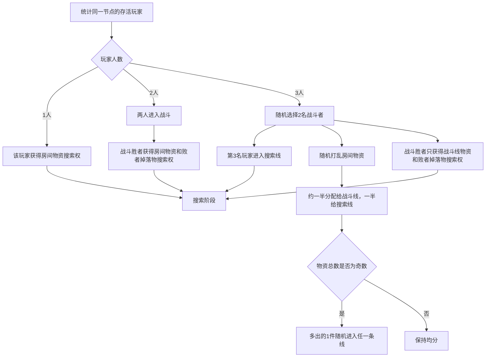
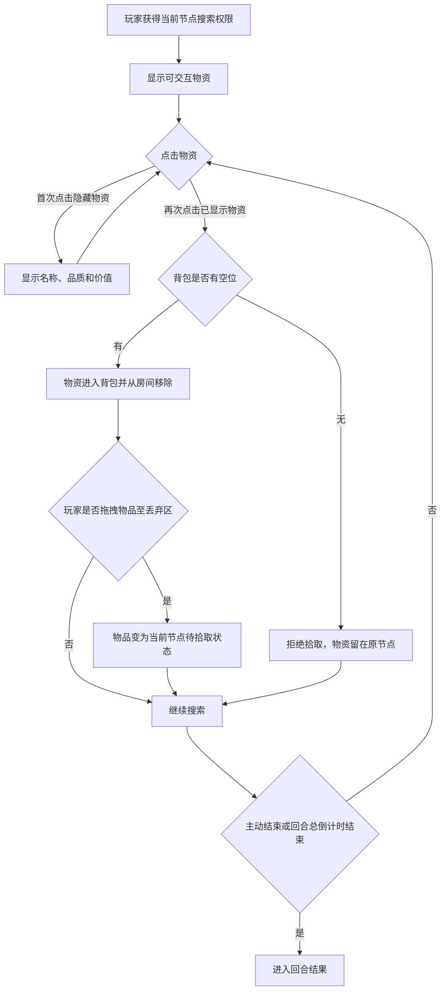
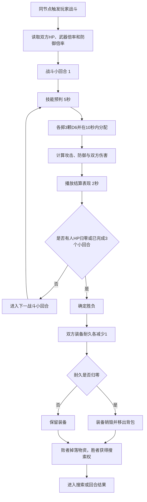
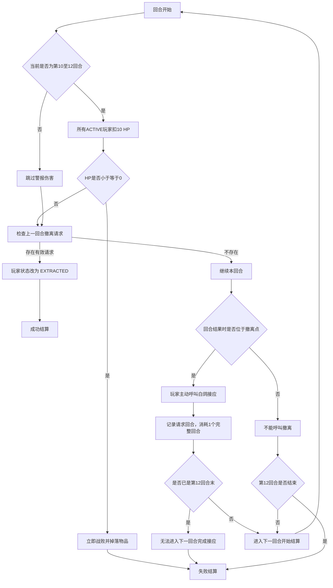

# 《大劫卡西诺》游戏产品流程图

文档版本：1.0.0
最后更新：2026-10-20
维护责任：PMO/产品经理确认规则，开发同步流程图、实现、测试与变更日志

## 1. 文档定位

本文是项目从产品规则到技术实现的流程单一事实源，覆盖玩家从启动游戏到完成结算的全部步骤、节点规则、状态转换和例外处理。

规则状态分为三类：

| 标记 | 含义 | 开发要求 |
|---|---|---|
| `已冻结` | PMO 已明确确认，可作为正式实现依据 | 代码、测试和流程图必须保持一致 |
| `M2 临时` | 为当前本地测试包完成闭环而采用 | 进入正式联机开发前替换或再次确认 |
| `待确认` | 不阻塞当前原型，但存在产品边界 | 不得擅自升级为正式规则 |

规则发生变化时，必须同时更新：

1. 本文对应流程图和规则表。
2. “产品决策台账”，新增决策编号；不得覆盖或删除历史决策。
3. “文档变更日志”，说明修改范围。
4. 对应代码、配置和自动化测试。
5. 若视觉或交互受影响，同步更新验收文档和美术需求。

## 2. 产品全流程

## 3. 启动与主页流程

| 步骤 | 输入/条件 | 系统处理 | 输出/下一状态 | 状态 |
|---|---|---|---|---|
| 启动 | 玩家打开小游戏 | 初始化 Canvas、读取窗口尺寸、加载卡牌和视觉资源 | 加载页 | 已冻结 |
| 加载成功 | 所有核心资源完成或已有降级方案 | 进入主页 | 开始游戏界面 | 已冻结 |
| 开始游戏 | 点击主页主按钮 | 创建本地匹配会话 | 匹配界面 | 已冻结 |
| 装备整备 | 点击装备入口 | 当前仅提示尚未开放 | 留在主页 | M2 临时 |
| 地图选择 | 点击地图入口 | 当前展示卡西诺主岛提示 | 留在主页 | M2 临时 |
| 声音 | 任意场景 | 不创建或播放音频 | 全局静音 | 已冻结 |

## 4. 匹配与房间生命周期

匹配规则：

| 规则 | 说明 | 状态 |
|---|---|---|
| 房间人数 | 每局固定 3 人 | 已冻结 |
| 最大等待 | 匹配最长 5 分钟 | 已冻结 |
| 主动取消 | 玩家可在等待期间取消；只移除当前玩家 | 已冻结 |
| 房间销毁 | 房间人数归零或匹配超时时销毁 | 已冻结 |
| 未空房间 | 仍有玩家时继续等待，直至满员或超时 | 已冻结 |
| 标准匹配演示 | M2 在约 1.8 秒、3.6 秒模拟两名玩家加入 | M2 临时 |
| 单人测试 | 点击后立即补齐两个机器人并开始 | M2 临时 |
| 正式匹配 | 由 CloudBase 权威房间服务分配、计时和广播 | 待开发 |

## 5. 对局初始化

初始化规则：

| 项目 | 当前规则 | 状态 |
|---|---|---|
| 地图 | 5×5 逻辑节点 | 已冻结 |
| 出生点 | `(0,0)`、`(0,4)`、`(4,0)` 三个角点 | 已冻结 |
| 撤离点 | `(4,4)`，全图唯一 | 已冻结 |
| 中央金库 | `(2,2)`；第 1–5 回合锁定，第 6 回合开放 | 已冻结 |
| 初始生命 | 每名玩家 30 HP | 已冻结 |
| 背包容量 | 8 格，装备占用背包槽位 | 当前基线 |
| 初始装备 | 测试包按玩家分配固定武器 | M2 临时 |
| PvE | MVP 不生成 PvE 敌人 | 已冻结 |

## 6. 回合状态机

回合执行顺序不可交换：

1. 清理上一回合临时选择、搜索权限和遭遇数据。
2. 第 10–12 回合先对存活玩家结算警报圈伤害 `-10 HP`。
3. HP 归零或以下的玩家立即战败并掉落全部未销毁物品。
4. 对仍存活玩家检查上一回合发起的撤离，满足条件则完成撤离。
5. 检查本地玩家和整局是否已进入终局。
6. 存活玩家进入移动选择阶段。

> 因警报圈先于撤离完成结算，玩家以 10 HP 在第 9 回合呼叫撤离，会在第 10 回合先被警报击败，不能成功撤离。

## 7. 移动选择与节点判定

移动规则：

- 每回合只能停留，或移动到上下左右一个相邻节点。
- 不允许斜向移动、跨越节点或走出 5×5 地图。
- 所有玩家同时选择；提交前看不到其他玩家目的地和节点人数。
- 全员完成选择可提前结算；15 秒结束仍未操作的玩家视为停留。
- 统一结算后才显示三名玩家的移动轨迹。
- 抵达撤离点不会立刻成功；应先完成该节点遭遇，再由存活玩家主动呼叫撤离。

## 8. 地图节点规则

| 节点类型 | 坐标/范围 | 可进入条件 | 进入后处理 | 物资规则 | 状态 |
|---|---|---|---|---|---|
| 出生节点 | 三个出生角点 | 正常移动规则 | 按节点人数触发搜索/战斗 | 未拾取和掉落物保留 | 已冻结 |
| 普通房间 | 除特殊点外节点 | 正常移动规则 | 按节点人数触发搜索/战斗 | 第一次显示、第二次拾取 | 已冻结 |
| 中央金库 | `(2,2)` | 第 6 回合起可进入 | 与普通节点采用同一遭遇逻辑 | 当前测试包生成 3 件物资 | 部分临时 |
| 唯一撤离点 | `(4,4)` | 正常移动规则 | 先处理同节点遭遇，再允许呼叫撤离 | 当前不生成固定房间物资；可存在玩家掉落物 | 已冻结 |

## 9. 节点人数与遭遇分流

关键约束：同一件房间物资在三人分流时只能分配一次，不得同时出现在战斗线和搜索线。

## 10. 搜索、拾取、背包与丢弃

搜索与资产规则：

| 规则 | 说明 | 状态 |
|---|---|---|
| 两段式交互 | 第一次点击显示，第二次点击拾取 | 已冻结 |
| 搜索时间 | 使用 55 秒回合总时限扣除移动阶段后的剩余时间 | 当前基线 |
| 满包处理 | 无法拾取，物品保持在房间 | 已冻结 |
| 未拾取物 | 跨回合保留在原节点 | 已冻结 |
| 主动丢弃 | 拖至右下角丢弃区，物品留在当前节点 | 已冻结 |
| 战败掉落 | 战败者全部未销毁物品进入当前节点待拾取状态 | 已冻结 |
| 装备占格 | 武器和防具均占背包槽位 | 已冻结 |
| 装备价值 | 等于对应购买价；当前部分购买价未补齐，数值状态为 `BLOCKED` | 已冻结/待数据 |
| 同价值排序 | 价值相同的物品保持默认稳定顺序 | 已冻结 |

## 11. 战斗流程

正式目标规则：

- 每场战斗最多 3 个小回合。
- 每个小回合为：技能预判 5 秒 → 3D6 分配 10 秒 → 攻防结算与动画 2 秒。
- 三颗骰子可自由分配到攻击区和防御区。
- 攻击值为攻击骰点数和乘以卡牌攻击倍率；防御值按防御骰和防御倍率计算。
- 单次伤害不低于 0，并从目标当前 HP 扣除。
- 有玩家 HP 归零时立即结束战斗。
- 三轮后优先比较累计造成伤害；相同则比较剩余生命值。
- 武器和防具最大耐久统一为 2；完成一场战斗消耗 1 点耐久。
- 战斗进行期间不结算警报圈伤害。

M2 测试替代：自动掷骰，并将两颗最大骰分配至攻击、一颗分配至防御；技能预判和真人拖拽分配尚未接入。

待确认边界：累计伤害与剩余 HP 都完全相同时，当前实现为双方均不淘汰。

## 12. 警报圈、撤离与终局结算

终局状态：

| 状态 | 触发条件 | 资产结果 | 结算结果 |
|---|---|---|---|
| `EXTRACTED` | 在撤离点呼叫接应，经过一回合且回合开始时仍存活 | 统计背包物品及总价值 | 成功 |
| `DEFEATED` | 战斗或警报圈使玩家战败 | 未销毁物品掉落在节点 | 失败 |
| `TIMED_OUT` | 第 12 回合结束仍未完成撤离 | 当前局资产判定损失 | 失败 |
| `ACTIVE` 提前结束 | 其他玩家均离场或战败，仅剩一人 | 尚未冻结 | 待确认 |

结算页至少展示：成功/失败、原因、最终回合、剩余 HP、背包物品数、战利品总价值，并提供“返回码头”和“再来一局”。

## 13. 产品状态与技术权威边界

| 领域 | M2 本地测试包 | 正式联网目标 |
|---|---|---|
| 匹配 | 本地会话和模拟玩家 | CloudBase 匹配/房间服务 |
| 倒计时 | 客户端本地时间 | 服务端时间为准 |
| 随机数 | 本地可复现随机数 | 服务端生成并记录种子/结果 |
| 移动 | 本地统一结算 | 服务端收集后广播 |
| 战斗 | 本地自动结算 | 服务端权威结算，客户端提交选择 |
| 掉落/拾取 | 本地状态 | 服务端校验所有权和并发操作 |
| 最终资产 | 仅本局展示 | 服务端校验并持久化 |
| 断线恢复 | 未实现 | 房间快照与重连恢复 |

## 14. 当前待确认规则

| 编号 | 问题 | 当前 M2 处理 | 影响范围 |
|---|---|---|---|
| P-001 | 第 12 回合到达撤离点后才呼叫，能否成功 | 无法完成第 13 回合接应，判定失败 | 撤离、结算、提示文案 |
| P-002 | 其他两人均战败后，最后存活者如何结算 | 提前结束，但不自动判定撤离成功 | 终局状态机、资产结算 |
| P-003 | 55 秒中移动/搜索时间如何冻结 | 移动最多 15 秒，搜索使用剩余总时间 | 倒计时、服务端同步 |
| P-004 | 战斗完全平局如何处理 | 双方均不淘汰 | 战斗结果、物资归属 |
| P-005 | 双方同一小回合同时降至 0 HP | 尚未形成正式产品规则 | 战斗结果、掉落归属 |
| P-006 | 中央金库正式物资数量和掉落表 | M2 固定生成 3 件测试物资 | 地图数值、配置系统 |

## 15. 产品决策台账

台账只追加、不删除。若旧决策失效，将其状态改为“已被替代”，并在“关联”中填写新决策编号。

| 决策编号 | 日期 | 决策内容 | 状态 | 关联/影响 |
|---|---|---|---|---|
| DEC-001 | 2026-10-19 | 首版声音全部静音，后续再由音效组接入 | 已冻结 | 全客户端 |
| DEC-002 | 2026-10-19 | 匹配最长 5 分钟；玩家可取消；房间为空或超时时销毁 | 已冻结 | 匹配服务 |
| DEC-003 | 2026-10-19 | 每回合仅能停留或移动到相邻节点；同时提交；超时未操作视为停留 | 已冻结 | 移动状态机 |
| DEC-004 | 2026-10-19 | 移动选择阶段隐藏其他玩家节点人数和目的地，结算后统一显示轨迹 | 已冻结 | 地图 UI、同步协议 |
| DEC-005 | 2026-10-19 | MVP 暂不实现 PvE | 已冻结 | MVP 范围 |
| DEC-006 | 2026-10-19 | 三人同节点时随机两人战斗、一人搜索；物资随机分半 | 已冻结 | 遭遇结算 |
| DEC-007 | 2026-10-19 | 搜索物品第一次点击显示、第二次点击拾取；搜索受倒计时限制 | 已冻结 | 搜索交互 |
| DEC-008 | 2026-10-19 | 满包不能拾取；未拾取、丢弃及战败掉落物均保留在节点 | 已冻结 | 背包、房间状态 |
| DEC-009 | 2026-10-19 | 装备占背包槽位，装备价值等于购买价，同价值维持默认排序 | 已冻结 | 资产系统 |
| DEC-010 | 2026-10-19 | 警报圈改为第 10 回合开始，每回合开始扣 10 HP，归零立即战败，战斗中不扣除 | 已冻结 | 替代早期第13回合描述 |
| DEC-011 | 2026-10-19 | 武器和防具最大耐久统一为 2；卡牌倍率以卡牌文档为准 | 已冻结 | 卡牌、战斗 |
| DEC-012 | 2026-10-19 | 卡牌系统先按现有内容开发，并保留可持续扩展的数据结构 | 已冻结 | 数据 Schema |
| DEC-013 | 2026-10-19 | 匹配房间只要未空就继续等待；为空时销毁 | 已冻结 | 补充 DEC-002 |
| DEC-014 | 2026-10-19 | 当前测试包增加单人直接开始规则 | M2 临时 | 构建开关、匹配 UI |
| DEC-015 | 2026-10-19 | 产品原型必须覆盖开始、匹配、移动、搜索/战斗、撤离结算完整流程 | 已冻结 | M2 范围 |
| DEC-016 | 2026-10-19 | UI 根据现有视觉定义制作相对高保真横屏游戏画面 | 已冻结 | 视觉实现 |
| DEC-017 | 2026-10-20 | 在 GitHub 建立产品流程图，并持续沉淀规则、优化决策和文档变更日志 | 已冻结 | 本文及协作流程 |

## 16. 文档变更日志

| 文档版本 | 日期 | 变更内容 | 关联决策 | 修改者 |
|---|---|---|---|---|
| 1.0.0 | 2026-10-20 | 首次建立产品全流程；整合 M1/M2、PMO 已确认规则、临时实现、待确认边界和历史决策 | DEC-001 至 DEC-017 | Codex |

### 后续记录格式

每次变更至少包含：

- 版本号和日期。
- PMO 决策编号。
- 修改前规则和修改后规则。
- 受影响的流程节点、页面、配置、接口和测试。
- 实现提交的 Git commit；若尚未实现则标记“仅文档确认”。
- 验收结果和遗留问题。
