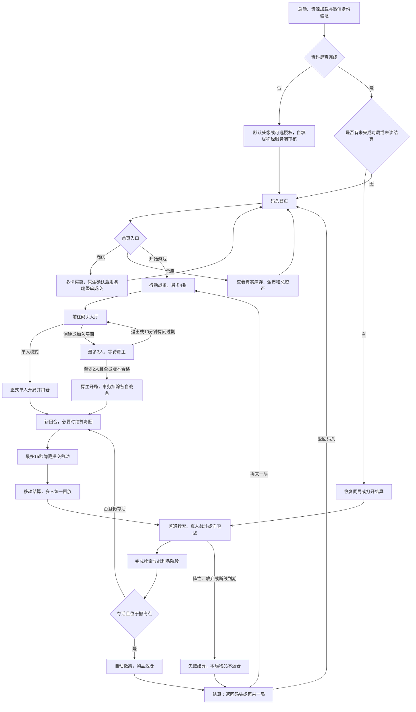
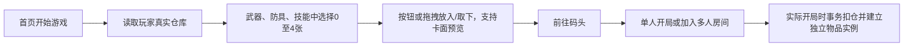
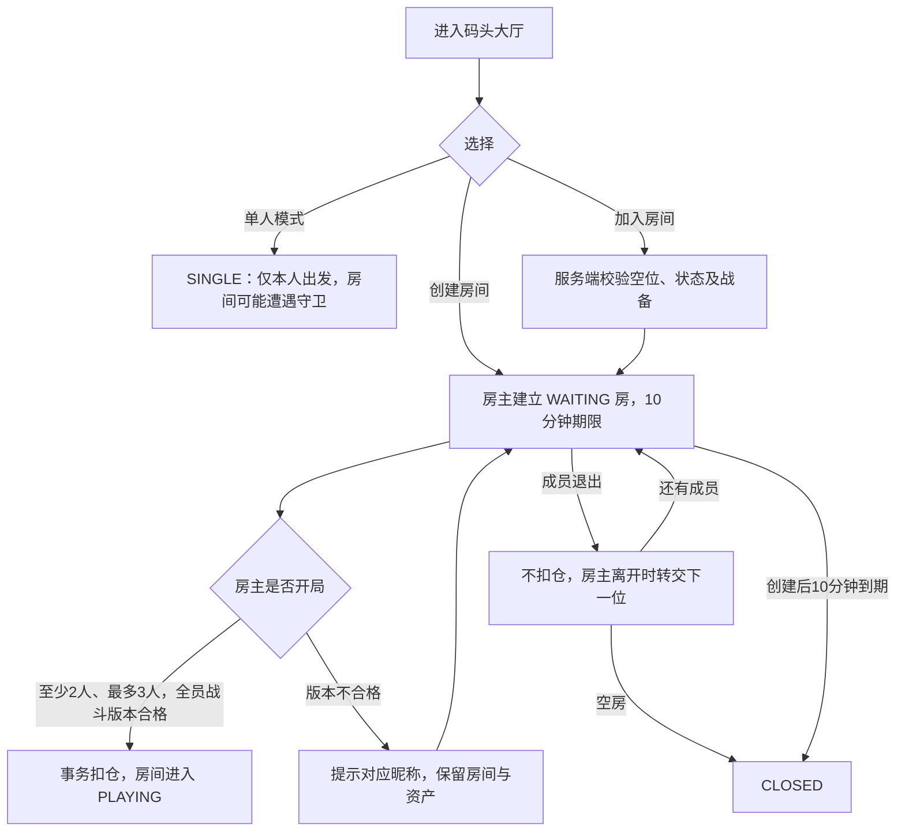
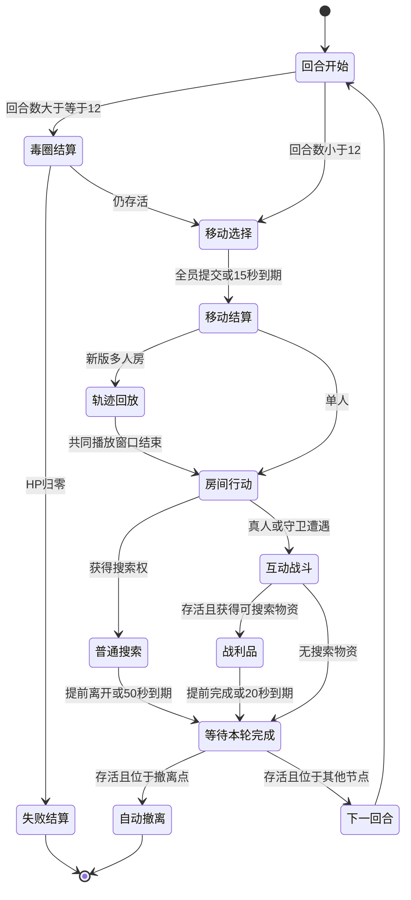
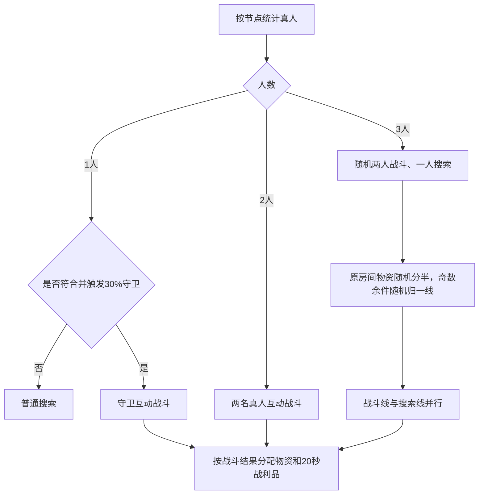
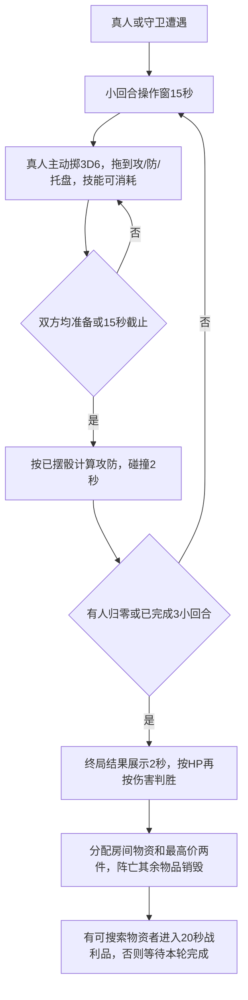

# 《大劫卡西诺》游戏产品流程图

文档版本：2.0.2
最后更新：2026-11-23（仅新增后续需求引用）
实现基线：`403bd45`（2026-11-12；本次仅整理文档）
维护责任：PMO/产品经理确认新规则，开发同步实现、文档、测试与发布记录。

## 1. 文档定位与证据边界

本文描述当前客户端实际入口及服务端执行规则。与旧版里程碑文档冲突时，以当前代码、[全局回归测试用例](全局回归测试用例.md)和本文当前章节为准；第 16–17 节保留历史决策与演进记录。没有实现的设想只标“待定”，不作为验收要求。

| 标记 | 含义 |
|---|---|
| 当前实现 | 可由代码及自动化验证的现有行为 |
| 线上验证记录 | 指定提交已有 CloudBase 部署和公网业务验证；不代表今天重新核验 |
| 待真机验收 | 微信原生能力、真实手机帧率或多机画面尚缺最新版验收记录 |
| 待定 | 尚未实现或未确定的后续产品范围 |
| 历史/兼容 | 旧里程碑规则或保留的旧局、旧接口路径，不是当前新局主流程 |

当前账号、单人、真人多人和资产结算统一由 `/api/account` 权威执行；断网不能通过本地降级改写账号资产。旧本地匹配模型与 `/api/search` 独立搜索保留兼容。CloudBase 部署、隔离账号公网验证和真机验收分别记录，不能相互替代，见[发布记录](CloudBase发布与验收.md)。

核对入口：[客户端页面与触控](../client/js/main.js)、[账号服务](../functions/heisino-account/service.js)、[多人房间](../functions/heisino-account/multiplayer.js)、[互动战斗](../functions/heisino-account/combat-round.js)、[规则引擎](../client/js/core/game-engine.js)、[房型掉落](../client/js/core/room-loot.js)。

## 2. 产品全流程

恢复是服务端返回当前有效阶段，不固定回到搜索；图中的恢复支线概括移动、战斗、搜索和结算恢复。

## 3. 启动、账号与主页

- 冷启动通过 `wx.login` 重新确认当前微信身份，不能直接沿用上一个微信用户的缓存仓库。身份变化时停止旧操作的跨账号重试。
- 首次资料可使用默认头像与自填昵称。昵称为 2–16 个汉字、英文字母、数字或下划线，经 NFKC 规范化、格式校验及微信内容审核；审核失败不能绕过。
- 首次建号仅发放一次 `wp_006`、`ar_001`、`sk_001` 各 1 张，金币为 0。礼包、扣仓、交易、返仓以服务端事务与资产流水为准。
- 首页为夜间离岸码头，保留商店、仓库、开始游戏三个入口。按 Figma 分层设计与横屏安全区等比布局；背景铺满，前景元素不得被微信胶囊遮挡。
- 当前有效卡库 51 张：武器 7、防具 13、物资 23、技能 8，使用 50 张新版 JPEG；守卫圆盾复用赌场圆盾卡面。退役卡 `sk_002`、`sk_003`、`loot_008` 不展示、不入局，旧资产访问时清理并保留历史流水。
- 卡库失败可回退内置目录，卡面按需加载；账号接口失败保留错误和重试，不本地补写资产。
- 全局保持静音。500ms 轻点击反馈只表示收到触控，不表示服务端操作成功。

仓库按服务端持有数量显示，默认“全部”筛选；同卡每格最多 99 张，100 张显示 99+1。总资产为金币加所有库存卡牌售价，切换分类不改变总资产。轻点卡牌打开居中大图与黑色蒙层，无底部效果说明；再点任意位置关闭，长按、滚动及拖拽不会误开预览。

商店货架出售 A/B 级武器、防具、技能共 16 种，买价为售价的 120%；玩家可出售四类持有卡牌，包括 S/SS 和守卫圆盾（圆盾售 1 金币且不能买入）。左栏逐张加入订单，右栏每格一张，可移回；待售剩余数量归零时隐藏。确认后整单事务成交，余额、库存、报价或阶段不合法时整单不变。同单超时沿用原请求号，支持冷启动后确认原订单。已加入房间或有未完成对局时不能交易。

## 4. 行动战备

| 项目 | 当前规则 |
|---|---|
| 页面结构 | NPC 引导、中间“仓库”、右侧 10 格行动背包、返回首页与“前往码头” |
| 所有权 | 仅可选择账号实际拥有的卡及数量；选择阶段不扣云端库存 |
| 卡牌范围 | 仅武器、防具、技能，不显示或允许带入物资卡 |
| 上限 | 最多 4 张；当前互动战斗新局最多 1 张武器、1 张防具，其余可为技能 |
| 空手出发 | 允许；没有武器或防具的一侧战斗倍率为 40% |
| 操作 | 轻点预览后点放入/放回按钮，或横向拖拽；纵向手势滚动 |
| 初始装备 | 所选卡写入实际初始背包，武器和防具参与攻防并各占一个背包槽 |
| 选择保留 | 未开局选择在会话内保留；真正开局才扣仓，多人等待/退出不扣仓 |

## 5. 码头大厅、单人和多人房间

- 大厅列出待开始房间，可展开游戏中房间，支持分页；已开始的房间不能加入。容量以服务端查询为准，不能依赖陈旧列表判定满房。
- 2–3 人均由房主主动开局，不自动补机器人，不要求固定 3 人。开局核对全员 `combatVersion`；不符时返回 `409 PLAYER_VERSION_TOO_LOW` 和昵称，等待房保留且不扣仓。
- 房间期限为创建后 10 分钟（`multiplayer.js` 的 `WAIT_MS`）；满员、房主转让不重置该期限。
- 正式单人模式为 `SINGLE`，只有本人在地图行动，守卫仅在遭遇时生成。`STANDARD`、`SINGLE_TEST`、5 分钟本地模拟匹配仍作旧协议/测试兼容，不是当前客户端主入口。
- 当前使用 HTTP 请求、心跳和房间快照同步；没有实施 WebSocket 推送或自动排位匹配。

## 6. 对局初始化与地图

| 项目 | 当前规则 |
|---|---|
| 地图 | 5×5 节点；房间图块不叠加房名，图例、选点目标与进房标题显示房名 |
| 出生点 | 单人 `(0,0)`；多人依成员顺序分配 `(0,0)`、`(0,4)`、`(4,0)` |
| 初始生命 | 每名真人 30 HP，守卫也满血开始 |
| 中央金库 | `(2,2)`，第 1–5 回合锁定，第 6 回合开放 |
| 唯一撤离点 | `(4,4)` |
| 背包 | 局内每张卡按独立实例占一格，容量 10；武器、防具占格，同款不堆叠 |
| 房间库存 | 首次实际访问时按房型数量和权重生成，未访问房间不预生成完整物品 |
| 兼容 | 旧局原数量与超额物品保留，超十件可翻页查看/丢弃；不能借兼容额外拾取 |

地图当前房间采用最亮绿色，可移动房间次级绿色，已选目标强化描边；其他房间 50% 黑色蒙层。红金图针在原位置渐隐、目标位置渐现；金库叠加宝箱，撤离点叠加出口。地图遮罩不得遮挡 HUD。左上角背包入口只读查看，关闭后才恢复地图触控；跨阶段旧手势不能触发下层操作。

## 7. 回合状态机

三人同房的轮空搜索与战斗可并行，不同房间的守卫战与搜索也可并行；全体存活玩家完成本轮行动后才换轮。整回合没有固定 55 秒总上限，也不在第 12 回合强制结束。

## 8. 移动选择与轨迹回放

- 仅可停留或走上下左右相邻节点；禁止斜向、跨格、越界和提前进入锁定金库。
- 服务端最多收集 15 秒隐藏选择；全员提交可提前结算，超时未提交者原地停留。截止后首次提交拒绝，截止前已成功的请求可用原请求号重试。
- 选择阶段不公开对手位置、目的地与节点人数；结算后才公布本回合轨迹。
- 新版多人房间按同一服务端窗口播放：结算后预留 600ms 同步，回放 1.2 秒，结束后开放房间，普通搜索从 50 秒开始。较晚恢复仅播放剩余窗口。旧混合版本房间沿用即时进房兼容。
- 移动请求不被慢心跳占住交互锁，迟到回包不能回滚新位置；场景切换取消旧触摸。

## 9. 地图节点与守卫

| 节点 | 固定房间库存 | 当前遭遇规则 |
|---|---|---|
| 三个出生点 | 0 件 | 可有真人遭遇及玩家丢弃/掉落物，不生成守卫 |
| 普通房间 | 首访随机 0–4 件 | 独自进入可搜索或遭遇守卫；多人同房按人数分流 |
| 中央金库 | 首访随机 6–10 件 | 第 6 回合开放后采用普通遭遇逻辑 |
| 撤离点 | 0 件 | 不生成守卫；先处理当轮真人战斗、搜索及战利品，再自动撤离 |

单人新局每个大回合在合格房间判定 30% 守卫概率，原地停留也会进入该判定；多人仅在独自移动到普通房间/已开放金库时判定 30%，原地停留、真人同房及三人轮空搜索不判定。守卫不占真人名额，沿用满血、两骰一攻一防与蓝装规则。旧局保留历史守卫判定兼容。

## 10. 节点人数与遭遇分流

同一件房间物资只能分配一次；轮空玩家不能拾取战斗线独占实例，守卫只显示给对应参战者。

## 11. 搜索、拾取与背包

| 项目 | 当前实现 |
|---|---|
| 数量分布 | 普通房间 0/1/2/3/4 件概率为 20%/20%/30%/20%/10%；金库 6/7/8/9/10 件概率为 40%/10%/10%/10%/30% |
| 卡牌抽取 | 按房型权重表有放回抽取；数量和卡牌权重使用独立随机流，缺省卡牌权重为 1 |
| 首访与重进 | 首访生成后不补货，抽到空房也不补；拾取、丢弃及重连保留现状，玩家/守卫掉落另计 |
| 区域 | 左柜台、中央牌桌、右牌桌，允许空区域；底图按五种房型读取本地分包，出生/撤离或缺图沿用可操作的备用场景 |
| 揭示 | 普通搜索进入区域后每 0.5 秒揭示一件并保留；未揭示使用本地卡背；战后 LOOT 区域立即揭示 |
| 区域容量 | 每区域最多 30 件，首屏 10 格，超出可纵向滚动 |
| 时限 | 普通房间页与搜索浮层共用独立 50 秒服务端期限；战后战利品为 20 秒 |
| 拾取 | 将右侧已揭示卡拖入背包，事务成功才写入权威状态；每件独立占格 |
| 满包与装备限制 | 十格满时拒绝拾取且保留原物；当前新局最多 1 武器、1 防具，须先丢旧同类装备才能拾取另一件 |
| 丢弃 | 拖回当前区域后按实例丢弃，物品留在原房间；不按整类或整堆清空 |
| 完成与离开 | “完成搜索”返回房间页；离开房间或到期标记个人行动完成，多人等待其他人，单人推进下一轮 |
| 幂等与恢复 | 请求号防重复入包，迟到/跨回合拖拽不提交；账号资产不允许本地降级写入 |
| 估值 | 背包总值含已装备物各一次；差值=当前持有卡售价总和−开局带入价值；拾取、丢弃、技能消耗、没收和恢复均取服务端快照 |

## 12. 当前互动战斗

- 每场最多 3 个小回合，每轮统一 15 秒操作窗；当前没有独立的 5 秒技能预判阶段。
- 真人每轮只能主动掷骰一次，每颗骰子可放攻击、防御或托盘；0–3 颗均可参与攻防。未掷骰不自动补掷，托盘骰不计分。
- 未掷骰或仅摆部分骰子也可准备；对手未准备时可取消并保留摆放。双方准备立即结算；未准备但到期仍按已摆攻防区的骰子计分。
- 摆放本地即时反馈、后台同步；版本号及请求号防止乱序覆盖和重复操作。准备时提交最新完整布局；已进入结算不能取消。
- 攻/防值分别为相应骰子点数和乘装备百分比后向下取整；未带武器/防具的一侧为 40%。守卫每轮自动两颗骰子随机一攻一防，缩放后大于 0 且小于 1 的值计 1。
- 双方伤害同时计算，每方实际扣血为 `min(自身HP, max(0, 对方攻击−自身防御))`。碰撞阶段 2 秒，只显示实际攻防；终局再展示结果 2 秒。
- 胜负先比较剩余 HP，再比较累计造成伤害。完全相同为平局；双方同时归零时不发战利品。存活败者仍可继续对局，不因输一场直接淘汰。
- 有胜者时，真人胜者获得本战斗线房间物资及败者售价最高的两件（不足两件取实际数量，同价按背包顺序）。阵亡/弃权者其余物品销毁。守卫获胜则没收并销毁玩家最高价两件，玩家若仍存活保留其余物品继续；击败守卫可拾其蓝装。
- 真人平局且存活时房间物资随机均分，奇数余件随机归一方；三人轮空线原分配不变。只有实际获得可搜索物资且仍存活者开放 20 秒战利品，内容立即揭示，可提前完成。
- 技能每个小回合最多消耗一张，重复请求只消耗一次；**当前没有数值效果**。卡面技能描述不等于功能已执行，效果系统待定。
- 武器、防具无耐久，不因战斗次数消耗；警报圈只在大回合开场处理。多人参战者断线满十分钟停止参战，不能继续攻击在线玩家。

## 13. 毒圈、撤离、失败与恢复

| 项目 | 当前规则 |
|---|---|
| 毒圈 | 第 12 回合起，每轮开场存活玩家扣 5 HP；第 10/11 轮不扣，同轮心跳不重复扣 |
| 回合上限 | 不在第 12 回合强制终局，仍存活者继续移动、搜索或撤离 |
| 自动撤离 | 当轮全部行动完成时，存活且位于 `(4,4)` 的玩家自动 `EXTRACTED`；无需呼叫接应和再等一轮 |
| 撤离点遇敌 | 先战斗及完整战利品窗口；阵亡者失败，存活者当轮末撤离 |
| 成功资产 | 当前背包物品原样返仓并记录流水，价值仅估值，不自动兑换金币 |
| 失败资产 | `DEFEATED`、`ABANDONED`、`DISCONNECTED` 均不返本局物品，未带入的仓库库存保留 |
| 仅剩一人 | 继续前往撤离点，不自动获胜或返仓 |
| 单人恢复 | 不足十分钟恢复同局；没有 `game.combat` 的普通移动/搜索阶段可按服务端中断处理补偿计时；互动战斗及仍保留该战斗对象的同轮战利品按截止推进，恢复不会返回可操作的过期阶段 |
| 多人恢复 | 个别断线不暂停其他玩家；返回服务端当前阶段，满十分钟个人失败且停止参战 |
| 最终落盘 | 断线截止按服务端最后联系时间；请求/恢复触发推进与结算，没有已实现的后台定时清扫任务 |
| 结算确认 | 确认绑定本次 settlementId，旧确认不能吞掉新一局结算；重复结算不能再次返仓 |

毒圈归零由规则引擎将物品掉到当前节点；互动战斗阵亡物品按第 12 节处理，不能统一理解为所有战败均掉落全部物品。结算页显示结果、原因、回合、HP、物品数与价值，可返回码头或重新战备。

## 14. 技术权威与验收边界

| 领域 | 当前实现 | 验收证据及限制 |
|---|---|---|
| 身份与资产 | 微信登录、服务端审核、CloudBase 事务及流水 | 开发工具真实身份与公网隔离账号验证已有记录；可选头像授权与最新版真机资产路径独立验收 |
| 大厅与同步 | CloudBase 权威房间、HTTP 轮询和心跳，2–3 真人开局 | 多人业务已部署及隔离账号验证；多台实际手机画面待验收 |
| 计时与随机数 | 服务端截止、随机状态及快照，客户端只展示/提交选择 | 可控时钟自动化验证，不等于弱网手机手感验证 |
| 战斗与掉落 | 账号服务权威结算，客户端只提交掷骰/分配/准备/技能操作 | 已有公网业务记录；安卓/iOS 拖放、多机同步及后台恢复待验收 |
| 资源与性能 | 本地分包、远端卡面、缓存及按需绘制 | 自动化和模拟画面有覆盖；真机帧率、内存及弱网加载仍需记录 |
| 发布 | 三个云函数和卡面已有历次发布记录 | 记录只证明指定提交当时结果；健康检查不替代业务验证，旧二维码已失效 |

本次文档整理不重新部署服务器、不改变游戏规则，也不新增线上验证结论。当前进度与待办见[项目进度与待办](项目进度与待办.md)，文档入口见[文档导航](文档导航.md)。当前自动化索引和最新执行结果由[全局回归](全局回归测试用例.md)维护；历史五轮记录按其基线阅读。

## 15. 已澄清边界与待定范围

| 项目 | 当前处理 | 状态 |
|---|---|---|
| 原 P-002：仅剩一人 | 仍需撤离，成功才返仓 | 已实现，不再待确认 |
| 原 P-003：55秒分配 | 移动最多15秒，回放后普通搜索独立50秒，战后战利品20秒 | 已实现，旧总时限作废 |
| 原 P-004：完全平局 | 存活双方不淘汰，房间物资随机分半，奇数余件随机归一方 | 已实现 |
| 原 P-005：同时归零 | 双方失败，无战利品 | 已实现 |
| 原 P-006：金库物资 | 首访按权重随机6–10件，第6轮开放 | 已实现 |
| 技能卡使用逻辑、效果及独立预判阶段 | 当前仅消耗技能，不执行卡面效果；2026-11-23 补充 IT-09，使用规则、效果、数值与阶段设计另行确认 | 需求已记录，待细化/实施 |
| 自动匹配、排位、WebSocket推送 | 当前为手动大厅建房/加入及HTTP同步 | 待定 |
| 新卡牌附加效果、世界观任务、角色能力 | 内容设计稿不自动进入游戏功能范围 | 待定 |
| 可选微信头像及建号后补充头像入口 | 保留当前默认头像路径；原生授权与后续入口不视为已验收 | 待定/待真机验收 |
| 音效与背景音乐 | 当前仍静音；2026-11-23 用户已提出加入点击音效/BGM，见 IT-07 | 后续需求已记录，未实施 |
| 平衡与上线 | 实际手机测试、玩法数值内测、内容合规、隐私及微信发布准备 | 尚待完成 |

2026-11-23 用户新增及补充的 9 项目标见[迭代需求清单](迭代需求清单.md)，包括首页/大厅/地图/撤离 UI、逐局战绩、战斗与战后搜索、声音、新手引导和技能卡使用逻辑与规则。地图等待新稿，战斗判胜、合并物品及技能规则边界待确认；这些是后续需求，不覆盖前文当前实现。

## 16. 产品决策台账

台账保留原日期和原决策内容。2026-11-22 仅依据已有实现补充替代状态与章节引用，不新增策划决策；当前行为见第 1–15 节。后续新规则确认时追加决策，不覆盖历史内容。

| 决策编号 | 日期 | 决策内容 | 状态 | 关联/影响 |
|---|---|---|---|---|
| DEC-001 | 2026-10-19 | 首版声音全部静音，后续再由音效组接入 | 当前实现；后续接入已提出 | 2026-11-23 IT-07 已记录，未实施 |
| DEC-002 | 2026-10-19 | 匹配最长 5 分钟；玩家可取消；房间为空或超时时销毁 | 历史本地匹配规则 | 当前多人房等待 10 分钟，见第 5 节；旧匹配模型兼容保留 |
| DEC-003 | 2026-10-19 | 每回合仅能停留或移动到相邻节点；同时提交；超时未操作视为停留 | 已冻结 | 移动状态机 |
| DEC-004 | 2026-10-19 | 移动选择阶段隐藏其他玩家节点人数和目的地，结算后统一显示轨迹 | 已冻结 | 地图 UI、同步协议 |
| DEC-005 | 2026-10-19 | MVP 暂不实现 PvE | 已被当前实现替代 | 单人守卫及 DEC-032 多人守卫 |
| DEC-006 | 2026-10-19 | 三人同节点时随机两人战斗、一人搜索；物资随机分半 | 已冻结 | 遭遇结算 |
| DEC-007 | 2026-10-19 | 搜索物品第一次点击显示、第二次点击拾取；搜索受倒计时限制 | 已被替代 | DEC-026 与当前半秒揭示/拖拽拾取 |
| DEC-008 | 2026-10-19 | 满包不能拾取；未拾取、丢弃及战败掉落物均保留在节点 | 部分被替代 | 当前互动战斗只分配败者最高价两件，见第 12 节 |
| DEC-009 | 2026-10-19 | 装备占背包槽位，装备价值等于购买价，同价值维持默认排序 | 部分被替代 | DEC-033 将估值改为卡牌售价 |
| DEC-010 | 2026-10-19 | 警报圈改为第 10 回合开始，每回合开始扣 10 HP，归零立即战败，战斗中不扣除 | 已被替代 | DEC-031 |
| DEC-011 | 2026-10-19 | 武器和防具最大耐久统一为 2；卡牌倍率以卡牌文档为准 | 已被替代 | DEC-030 移除全部耐久规则 |
| DEC-012 | 2026-10-19 | 卡牌系统先按现有内容开发，并保留可持续扩展的数据结构 | 已冻结 | 数据 Schema |
| DEC-013 | 2026-10-19 | 匹配房间只要未空就继续等待；为空时销毁 | 已冻结 | 补充 DEC-002 |
| DEC-014 | 2026-10-19 | 当前测试包增加单人直接开始规则 | 历史测试入口 | 当前为正式 SINGLE 单人模式，旧 SINGLE_TEST 仅兼容 |
| DEC-015 | 2026-10-19 | 产品原型必须覆盖开始、匹配、移动、搜索/战斗、撤离结算完整流程 | 已冻结 | M2 范围 |
| DEC-016 | 2026-10-19 | UI 根据现有视觉定义制作相对高保真横屏游戏画面 | 已冻结 | 视觉实现 |
| DEC-017 | 2026-10-20 | 在 GitHub 建立产品流程图，并持续沉淀规则、优化决策和文档变更日志 | 已冻结 | 本文及协作流程 |
| DEC-018 | 2026-10-20 | 开始游戏后先进入战备页；默认拥有全部卡牌；背包10格、最多携带4张；支持拖拽或两段式点击放入；底部返回首页/开始匹配 | 部分被替代 | DEC-030 替换默认全卡所有权、增加堆叠 |
| DEC-019 | 2026-10-25 | 主页改为夜间离岸码头视觉；入口调整为商店、仓库、开始游戏；商店暂未开放，仓库默认展示用户拥有的全部卡牌，开始游戏继续进入既有战备与对局流程 | 部分被替代 | DEC-033 开放商店 |
| DEC-020 | 2026-10-25 | 移动回合采用中央赌场 5×5 房间设计；当前房间与可移动房间分别以金色、绿色高亮，其余房间添加 50% 黑色蒙层；动态 HUD 和房间图例不受蒙层影响 | 已被替代 | DEC-025；移动地图、HUD、房间点击热区 |
| DEC-021 | 2026-10-25 | 移动回合增加玩家地图图针；选择目标时图针从原位置渐隐并在目标位置渐现；当前房间与目标房间统一使用强绿色高亮 | 部分被替代 | DEC-025；移动地图、图针动画、房间高亮 |
| DEC-022 | 2026-10-25 | 玩家地图图针采用深红主体、金色描边与暖白中心，以匹配赌场整体美术风格并与绿色房间状态区分 | 当前实现 | 移动地图、图针视觉 |
| DEC-023 | 2026-10-25 | 56 份卡牌美术经 OCR 与哈希去重形成 52 张正式卡库；真实卡面存放在卡牌服务端，小程序通过接口拉取目录并按需加载卡面 | 历史数量，加载方式沿用 | 当前为 51 个有效 ID、50 张卡面，见第 3 节 |
| DEC-024 | 2026-10-25 | 后续迭代强制采用前后端联动开发流；联调与测试必须同时验证接口稳定性、数据正确性、资源可访问性、客户端降级和最终画面 | 已冻结 | 全部客户端、服务端、配置、测试与发布流程 |
| DEC-025 | 2026-10-26 | 移动回合中当前房间采用最高亮度绿色，可移动房间采用次级绿色，已选目标在次级层内强化描边；中央金库叠加宝箱图标，唯一撤离点叠加出口图标 | 当前实现 | 替代 DEC-020 的高亮颜色规则及 DEC-021 的同亮度规则；移动地图视觉层级 |
| DEC-026 | 2026-10-26 | 搜索轮改为进入房间后独立 50 秒；普通/出生房间 4 件、中央金库 10 件、撤离点 0 件；每 2 秒曝光 1 件且一次最多 2 件，拖拽拾取/丢弃由独立 CloudBase 搜索服务权威结算 | 部分被替代 | 50 秒沿用；当前随机数量、半秒逐件揭示及账号统一权威服务见第 11 节 |
| DEC-027 | 2026-10-29 | 玩家仓库与战备仓库取消点击分页，改用真实卡面比例的纵向滑动网格；只读仓库支持卡牌大图与底部说明；战备卡牌横向拖动时跟随手势，纵向手势保留滚动 | 部分被替代 | 当前统一居中卡面预览无底部说明，滚动和拖拽沿用 |
| DEC-028 | 2026-10-29 | 行动战备仅展示并允许携带武器、防具和技能卡；物资卡不在战备页展示，服务端建局同步过滤 | 当前实现 | 战备 UI、客户端战备模型、搜索服务建局接口 |
| DEC-029 | 2026-10-29 | 首页按 Figma `1:191` 的 1920×1080 分层设计还原；背景独立 cover 铺满，Logo、角色、黑猫、按钮和热区按安全区等比映射，保留商店/仓库/开始游戏既有业务逻辑 | 当前实现 | 首页 UI、Figma 素材、屏幕适配、入口热区 |
| DEC-030 | 2026-11-03 | 微信身份建号与可选头像昵称；三件首次礼包；真实账号库存、开局扣仓与原物返仓，单人测试同样承担得失；同卡99张一格；移除耐久；10分钟恢复。服务端运行现有机器人对局，仅剩自己仍需撤离 | 部分被当前实现替代 | 账号已部署；仓库 99 张堆叠、局内一格一件；当前单人与真人多人见第 5 节，真机验收独立记录 |
| DEC-031 | 2026-11-12 | 当轮行动结束时，撤离点的存活玩家自动撤离。毒圈从第 12 回合开始，每轮开场扣 5 HP | 当前实现 | 回合推进、撤离结算、毒圈提示 |
| DEC-032 | 2026-11-12 | 多人玩家独自移动到普通房间或已开放的金库时，有 30% 概率遇到守卫。守卫沿用单人战斗和掉落规则，各房间战斗与搜索可并行 | 当前实现 | 多人移动结算、战斗与搜索 |
| DEC-033 | 2026-11-12 | 商店按文档售价收购四类卡，按 120% 出售 A/B 武器、防具和技能；守卫圆盾专属掉落且可卖 1 金币。仓库显示金币和总资产，局内显示持有卡牌的资产与带入差值。战败最高两件按同一售价取，同价保留背包顺序。 | 当前实现 | 商店、资产、结算和战利品 |
| DEC-034 | 2026-11-12 | 地图左上角可查看背包，总价值和正负差值统一显示。商店多选买卖，右栏一格一张，待售数量归零隐藏，确认后整单结算。 | 当前实现 | 地图、背包、商店 |

## 17. 文档变更日志

| 文档版本 | 日期 | 变更内容 | 关联决策 | 修改者 |
|---|---|---|---|---|
| 2.0.2 | 2026-11-23 | 补充第 9 项技能卡使用逻辑与规则需求，关联 D-01；未确定新技能效果或更改实现 | IT-09 需求记录 | Codex |
| 2.0.1 | 2026-11-23 | 增加 8 项后续迭代需求入口，声音从后续设想转为已记录需求；保留当前实现和验收基线 | 需求记录，未修改功能 | Codex |
| 2.0.0 | 2026-11-22 | 按 `403bd45` 实现统一账号、2–3 人大厅、守卫、互动战斗、随机物资、半秒揭示、背包和资产；区分历史、当前及待定范围，未修改功能 | 实现基线归档，无新增产品决策 | Codex |
| 1.9.4 | 2026-11-12 | 地图背包入口、资产数字简化及商店多卡订单 | DEC-034 | Codex |
| 1.9.3 | 2026-11-12 | 开放商店并统一卡牌估值，新增仓库资产和局内盈亏 | DEC-033 | Codex |
| 1.9.2 | 2026-11-12 | 多人增加守卫遭遇 | DEC-032 | Codex |
| 1.9.1 | 2026-11-12 | 自动撤离及第 12 回合毒圈 | DEC-031 | Codex |
| 1.9.0 | 2026-11-03 | 接入账号与资产闭环，99张堆叠、无耐久、服务端机器人对局和10分钟恢复；新云函数待配置与真机验收 | DEC-030 | Codex |
| 1.8.0 | 2026-10-29 | 首页切换为 Figma 分层实现，增加背景铺满与前景安全区响应式适配 | DEC-029 | Codex |
| 1.7.0 | 2026-10-29 | 战备卡库排除物资卡，客户端与服务端统一校验可携带卡牌类型 | DEC-028 | Codex |
| 1.6.0 | 2026-10-29 | 仓库与战备仓库改为纵向滑动，统一真实卡面比例，增加仓库大图说明与战备跟手拖拽 | DEC-027 | Codex |
| 1.5.0 | 2026-10-26 | 建立房间页、50 秒搜索轮、定时曝光、拖拽拾取及服务端权威搜索契约 | DEC-026 | Codex |
| 1.4.2 | 2026-10-26 | 区分当前房间与可移动房间亮度，增加中央金库宝箱及撤离点出口地标 | DEC-025 | Codex |
| 1.4.1 | 2026-10-25 | 固化前后端契约、联调、联合测试与端到端验收要求 | DEC-024 | Codex |
| 1.4.0 | 2026-10-25 | 建立 52 张正式卡库、OCR 审计、卡牌服务和真实卡面客户端渲染 | DEC-023 | Codex |
| 1.3.2 | 2026-10-25 | 将移动地图图针调整为红金赌场风格 | DEC-022 | Codex |
| 1.3.1 | 2026-10-25 | 增加移动地图图针及渐隐/渐现动画，统一当前与目标房间的绿色高亮 | DEC-021 | Codex |
| 1.3.0 | 2026-10-25 | 重构移动回合 UI，增加 5×5 房间遮罩、高亮、动态 HUD 与设计稿坐标映射 | DEC-020 | Codex |
| 1.2.0 | 2026-10-25 | 更新主页视觉与三个入口，增加独立只读玩家仓库流程 | DEC-019 | Codex |
| 1.1.0 | 2026-10-20 | 在主页与匹配之间增加行动战备流程；补充10格背包、4卡上限、仓库交互和对局初始化规则 | DEC-018 | Codex |
| 1.0.0 | 2026-10-20 | 首次建立产品全流程；整合 M1/M2、PMO 已确认规则、临时实现、待确认边界和历史决策 | DEC-001 至 DEC-017 | Codex |

### 后续记录格式

每次变更至少包含：

- 版本号和日期。
- PMO 决策编号。
- 修改前规则和修改后规则。
- 受影响的流程节点、页面、配置、接口和测试。
- 实现提交的 Git commit；若尚未实现则标记“仅文档确认”。
- 验收结果和遗留问题。
